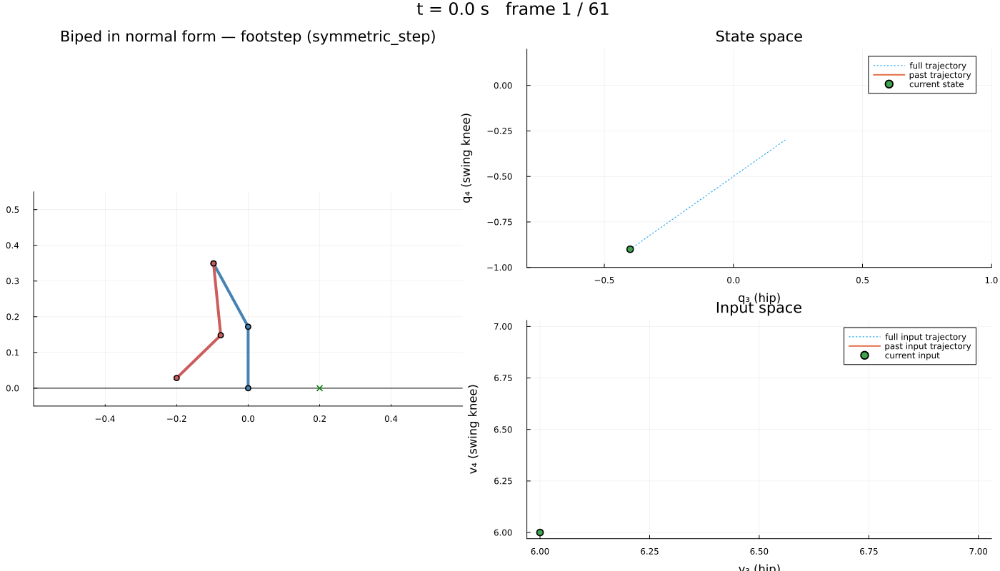
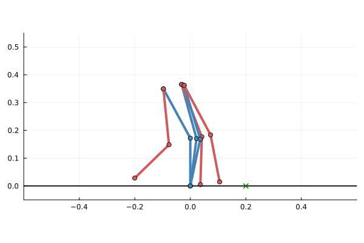

# The `biped_4d_normal_form.jl` experiment

`examples/BipedRobot/biped_4d_normal_form.jl` computes a certified abstraction of an underactuated
four-link biped and asks Dionysos for a controller that performs **one footstep**. Its default is a
**symmetric forward step** without obstacle (§6): the swing foot starts at `x = -0.2 m` and has to land
around the foothold at `x = +0.2 m`, the ankle falling forwards all along. `OBSTACLE = :bump` puts a bump
at the stance foot back, and
This document explains
what the experiment does, lists every parameter you can tune (with its default), walks through the
code step by step, and says what to do when no controller is found. The modules it relies on are
documented in [`symbolic_multibody_and_local_abstraction.md`](symbolic_multibody_and_local_abstraction.md)
(the file `robot_problem.jl` in its §4).

**Contents**

1. [What the experiment does](#1-what-the-experiment-does)
2. [Running it, and what a run prints](#2-running-it-and-what-a-run-prints)
3. [Tunable parameters](#3-tunable-parameters)
4. [Step-by-step walk-through of the code](#4-step-by-step-walk-through-of-the-code)
5. [Diagnosing a failed or slow run](#5-diagnosing-a-failed-or-slow-run)
6. [The default experiment: a symmetric forward step](#6-the-default-experiment-a-symmetric-forward-step)

---

## 1. What the experiment does

### 1.1 The robot

A planar biped with four joint angles and **no torque at the ankle**. In the notation of the code
(angles counter-clockwise, `q = 0` is the robot standing straight with both legs side by side):

| Coordinate | Meaning | Actuated? |
| :--- | :--- | :--- |
| `q₁` | grounded ankle, relative to the vertical | **no** |
| `q₂` | grounded knee (stance femur relative to stance tibia) | yes |
| `q₃` | hip (swing femur relative to stance femur) | yes |
| `q₄` | swing knee (swing tibia relative to swing femur) | yes |

The three motor joints are commanded **in velocity**: `u = (v₂, v₃, v₄)` is held constant over each
sampling period. The ankle obeys the first Euler–Lagrange row of the multibody model: it falls like
an inverted pendulum, and the controller can only influence it through the posture of the motor
joints (inertial coupling and gravity torque).

### 1.2 The model: normal form with the ankle *momentum*

The multibody model is built symbolically with `Multibody2D`, brought to normal form
`x = (q, v_a, p_u)` and reduced to a 5-dimensional model in which the unactuated ankle is
described by its **generalized momentum** `p₁ = ∂L/∂q̇₁ = (D q̇)₁`:

```
state   x = [p₁, q₁, q₂, q₃, q₄]          input  u = [v₂, v₃, v₄]
ẋ = [ ṗ₁, q̇₁, v₂, v₃, v₄ ],     q̇₁ = (p₁ − D₁ₐ v_a) / D₁₁ ,     ṗ₁ = ∂L/∂q₁ .
```

`p₁` takes the first slot of the state, so the geometry, obstacle carving, target set and plots of
`robot_problem.jl` are written for `[ankle, q₁, q₂, q₃, q₄]`. Because `p₁ ≈ D₁₁ q̇₁ + D₁ₐ·v_a` with
`D₁₁ ≈ 0.14 kg m²`, a momentum of `0.02 N m s` corresponds to about `0.15 rad/s` of ankle velocity.

### 1.3 The abstraction: local growth bounds

The state space is divided into hyper-rectangular cells and the inputs into a finite set of velocity
commands. For every `(cell, input)` pair the **reachable set after one sampling period** is
over-approximated by a box (the cell centre is simulated, and the box radius comes from a growth
bound computed *locally*, with interval arithmetic, for that cell and input; see the module
document). The result is a nondeterministic finite transition system on which a controller is
synthesized against the worst case, so a controller found on the abstraction is guaranteed to work on
the concrete system (up to numerical integration and the boundary convention of the module document,
§3.4).

The motor coordinates move by exactly one cell per step (the lattice trick of §3.2), so all the
nondeterminism is in the ankle `(q₁, p₁)`: the image box of a cell is wider than the cell, because
the unstable ankle expands it, so **every pair has two or three successor cells in each ankle
coordinate** (4.4 transitions per pair on average). The controller must succeed whichever of them
the "adversary" picks, at every step. This is what makes the problem hard (§5).

### 1.4 The specification

* **Foot-height constraint** (named `"ground"`). The swing foot must stay above the ground `z = 0`.
  Cells where the swing foot is *surely* below the ground are removed from the state space.
* **Obstacle at the origin** (named `"lift constraint"`, **off by default**: `OBSTACLE = :bump`). A
  triangular bump (8 cm wide, 3 cm high) sits at the stance foot. Every cell whose swing foot *might*
  touch it is removed, which forces the foot to lift.
* **Forward fall.** The state box bounds the ankle momentum above by `0`: `p₁ ≤ 0` is a forward fall of
  the ankle, and since a transition that would leave the box is forbidden, the controller keeps the
  momentum negative along the whole step (§3.3). It also halves the number of cells.
* **Footstep.** Starting from a configuration `q0`, with the ankle momentum in a given range (by default
  a single value), reach a configuration placing the swing foot at a foothold 20 cm in front of the
  stance foot, **within a tolerance** (`FOOTHOLD_TOLERANCE`), with the ankle momentum anywhere in a
  given range (by default any: the negative values of the box). The swing foot has no ground reaction
  force, so requiring rest at the start or at the end would be needlessly conservative. The tolerance is
  what makes the problem solvable (§5, §6): with `0.0` the foot has to land exactly on the foothold,
  a thin sliver of the angle space.

Both carvings are *sound*: they use a Lipschitz bound of the swing-foot map over a cell (the
"Lipschitz carving margin", 7.5 cm with the default grid), so they remove more than strictly
necessary. The target is the opposite, *optimistic*: it is made of the cells that **contain** a
configuration with the foot at the foothold (within the tolerance), so the concrete foot can end up to
one margin away from it (§6).

---

## 2. Running it, and what a run prints

### 2.1 Requirements

An environment with Dionysos (developed from this repository: the example locates
`problems/BipedRobot/4D_model_underactuated/` through `pathof(Dionysos)`), Symbolics,
IntervalArithmetic, LazySets, StaticArrays, MathOptInterface and Plots (loaded by
`robot_problem.jl`). RigidBodyDynamics is **not** needed. The `problems/BipedRobot` project lists all
of them, so `--project=problems/BipedRobot` (below) is enough.

```
julia -t auto --project=problems/BipedRobot examples/BipedRobot/biped_4d_normal_form.jl                # the symmetric forward step (§6)
```

Use several threads (`-t auto`): the abstraction is the expensive step and is threaded.

### 2.2 What it prints

The defaults of `biped_4d_normal_form.jl`, 10 threads (the abstraction took 70 s):

```
Symbolic normal form: NormalForm(8 states, 3 inputs; actuated = [2, 3, 4], unactuated = [1])
Carving the obstacle and the ground out of the state domain…
Lipschitz carving margin: 9.4 cm
State space: 123420 cells (123420 before carving), 3332340 (cell, input) pairs: about 13.3 M transitions and 1.1 min on 10 thread(s)
x0 = [-0.4, 0.0, 0.5, -0.4, -0.9]  (ṗ₁ at x0: 1.11)
swing foot at x0: [-0.2001, 0.0284]
[ Info: Number of states: 123420
[ Info: Number of inputs: 27
[ Info: Number of forward images: 3332340
transitions: 9327931
local growth bound statistics: (calls = 3332340, enclosure_failures = 0, unbounded = 0, improved = 3332340)
Optimal control terminated with success = true
footstep success: true
steps: 6, reached: true
ankle along the run: q₁ ∈ (-0.2094, 0.01468), p₁ ∈ (-0.4, -0.3522)
saved …/biped_4d_normal_form_symmetric_step.png
saved …/biped_4d_normal_form_symmetric_step_ankle.png
saved …/biped_4d_normal_form_symmetric_step.gif
```

The synthesis **succeeds** (§6 describes the step). With an obstacle (`OBSTACLE = :bump`) Dionysos also
prints a transitions warning ("Some transitions jump N cells per step while the state domain has
holes"), because the obstacle leaves holes in the domain and the abstraction does not sweep the
trajectories between samples. (The Lipschitz carving margin printed is that of the coarse grid, 9.4 cm; it
only matters with an obstacle.)

### 2.3 Know the size before you start: the cost of the abstraction

The abstraction computes one image per `(cell, input)` pair, about **0.2 ms of CPU time each** (21 µs of
wall time on 10 threads), and stores about **4 transitions per pair**. The number of cells is the
**product** of the cell counts along the five axes, so it reacts violently to the bounds. The
experiment therefore prints the size (`RP.abstraction_size`) right after the carving, before anything
expensive starts:

| State box `[p₁, q₁, q₂, q₃, q₄]` (grid steps `(0.02, 0.05, 0.1, 0.1, 0.1)`) | cells in the box | cells after carving the obstacle | pairs (× 27) | transitions | time (10 threads) |
| :--- | ---: | ---: | ---: | ---: | ---: |
| `[-0.2, 0.2] × [-0.3, 0.2] × [-0.5, 0.5] × [-0.8, 1.0] × [-1.0, 0.2]` (19 × 9 × 9 × 17 × 11) | 287 793 | 176 225 | 4.8 M | 19 M | ≈ 2 min |
| the current default `[-0.2, 0.2] × [-0.3, 0.3] × [-1.0, 0.2] × [-0.8, 1.0] × [-1.0, 0.2]` (19 × 11 × 11 × 17 × 11) | 429 913 | 260 718 | 7.0 M | 28 M | ≈ 2.5 min |
| `[-0.5, 0.5] × [-0.5, 0.5] × [-0.5, 0.5] × [-1, 1] × [-1, 1]` (49 × 19 × 9 × 19 × 19) | 3 024 819 | 1 961 470 | 53 M | 210 M | ≥ 18 min |

The box of the default experiment, `[-0.6, -0.08] × [-0.4, 0.2] × [-0.6, 0.6] × [-0.8, 1.0] × [-1.0, 0.2]`,
on the grid of the default (steps `(0.04, 0.1, 0.1, 0.1, 0.1)`), has 12 × 5 × 11 × 17 × 11 = 123 420
cells, none carved (no obstacle), 3.3 M pairs, 9.3 M transitions, 70 s: a coarser grid than the rows above
(whose steps are `(0.02, 0.05, 0.1, 0.1, 0.1)`) on a much larger momentum range.

The last box looks only "slightly" wider than the first, but has ten times more cells. It is the case
in which the run seems to hang: after the lines `Number of states / inputs / forward images` Dionysos
prints nothing until the abstraction is finished (`Starting threaded abstraction`, then silence),
and with 210 M transitions the memory (several gigabytes) and the garbage collector, not only the
interval arithmetic, dominate. The printed estimate is a lower bound on the time. Rules of thumb:

* widen a bound along an axis by a factor `a` and the cells are multiplied by `a`, along `k` axes by
  `aᵏ`; halving a cell size doubles the count along its axis (halving `dx` multiplies the cells by 8);
* the ankle momentum `p₁` is the cheapest axis to cut: `|p₁| ≤ 0.2` already covers ankle velocities up to
  about 1.2 rad/s, and a forward step only needs `p₁ ≤ 0` (the default experiment);
* only the cells **entirely inside** the box are kept, so a bound that is not on a cell boundary loses
  a partial cell (the box `[-0.2, 0.2]` on `p₁` has 19 cells, not 20).

### 2.4 Time of each step

| Step | Time (default run, 10 threads) |
| :--- | :--- |
| symbolic normal form (mostly compilation) | ≈ 10 s |
| carving the ground (≈ 7 s with the obstacle, compilation included) | < 1 s |
| `LocalGrowthBound` (symbolic Jacobian, compilation) | ≈ 1 s |
| abstraction (7.77 M `(cell, input)` pairs) | ≈ 165 s |
| controller synthesis | ≈ 2 s |

---

## 3. Tunable parameters

Parameters come in four kinds, from the easiest to change to the most invasive.

### 3.1 Variables you define *before* including the file

The example reads these with `@isdefined`, so you can run it from a driver script without editing
it. **Defaults are used for any variable you do not define.**

```julia
# driver.jl
using StaticArrays, Dionysos
const MP = Dionysos.Mapping
dx, dq1, dp, tstep = 0.1, 0.1, 0.06, 0.05                  # a coarser grid
du = dx / tstep
DISC = (; state_grid = MP.GridFree(zeros(SVector{5, Float64}), SVector(dp, dq1, dx, dx, dx)),
          input_grid = MP.GridFree(zeros(SVector{3, Float64}), SVector(du, du, du)),
          tstep, u_max = du, du)                           # u_max = input_steps · du
INITIAL_VELOCITY = (-0.05, 0.05)                            # start with a small ankle momentum
RUN_PLOTS = false
include(joinpath(dirname(dirname(pathof(Dionysos))), "examples", "BipedRobot", "biped_4d_normal_form.jl"))
```

(`include` resolves a relative path against the directory of the *script that calls it*, so use an
absolute path such as the one above, derived from where Dionysos is installed.)

The defaults below are those of the file at the time of writing; the file is the reference.

| Variable | Default | Meaning and constraints |
| :--- | :--- | :--- |
| **`DISC`** | `RP.default_discretization(; dx = 0.05, dq1 = 0.05, dq̇1 = 0.04, tstep = 1/60, input_steps = 1)` | Grids, sampling time and input range, a `NamedTuple` with fields `state_grid`, `input_grid`, `tstep`, `u_max` (see §3.2); `input_steps = k` gives `2k + 1` speeds per motor (§3.2). |
| **`X_BOUNDS`** | `(x_lb, x_ub) = (SVector(-0.6, -0.4, -0.6, -0.8, -1.0), SVector(-0.08, 0.2, 0.6, 1.0, 0.2))` | State box `[p₁, q₁, q₂, q₃, q₄]` (§3.3), with `p₁ ≤ -0.08`. **Its size is the cost of the run** (§2.3). |
| **`Q0`** | `SVector(0.0, 0.5, -0.4, -0.9)` | Initial **configuration** `[q₁, q₂, q₃, q₄]` (snapped to the grid): the swing foot at `(-0.200, 0.028)` m. Must be in the domain and not carved out (§3.4). |
| **`INITIAL_VELOCITY`** | `(-0.4, -0.4)` | `(vlo, vhi)` range of the first state coordinate `p₁` at the start: a **single value**, one cell of width 0.04. The controller must work from every cell the range touches (`(-0.44, -0.36)` touches three). `nothing` = the whole interval of definition of the box. |
| **`TARGET_VELOCITY`** | `nothing` = the whole interval `[x_lb[1], x_ub[1]]`, i.e. any negative momentum | `(vlo, vhi)` range of `p₁` at the end. The target is made of the cells lying entirely inside the range. |
| **`FOOTHOLD_TOLERANCE`** | `0.08` | Metres: the foot may land within this distance of the foothold along `x`, and up to this height above it. **With `0.0` no controller was found, for any start tried** (§5); `0.03` is enough for a 19 cm step from "feet together" (§5), `0.08` for the 40 cm step of the default on its coarse grid (§6). |
| **`OBSTACLE`** | `nothing` (no obstacle: only the ground constraint) | `:bump` (a triangle of half-width 4 cm and height 3 cm centred at `x = 0`), or a vector of `LazySets` polygons. |
| **`SCENARIO_NAME`** | `:symmetric_step` | Only used in the names of the output files. |
| **`ONE_JOINT_PER_STEP`** | `false` | `true` allows at most one moving motor joint per step (`1 + 6k` inputs instead of `(2k + 1)³`: 7 instead of 27 for `k = 1`, a much smaller automaton). |
| **`RUN_PLOTS`** | `true` | `false` skips the figures and the animation. |
| **`OUTPUT_DIR`** | the folder of the example | Directory of the figures and the animation (created if needed). The Slurm solve job sets it. |
| **`ABSTRACTION_FILE`** | `nothing` | Path of a file that caches the **transitions** of the abstraction: loaded if it exists (no computation), otherwise computed and written. The parameters that define the abstraction (`DISC`, `X_BOUNDS`, `ONE_JOINT_PER_STEP`, the obstacle) are stored in it and checked at loading. Used to compute the abstraction on a server (see [`slurm_array/`](../slurm_array/README.md)). |
| **`ABSTRACTION_ONLY`** | `false` | `true` stops after the abstraction (and its saving): no start-state synthesis, closed loop or plots. |

### 3.2 Grid cell sizes, sampling time and input set: `DISC`

`RP.default_discretization(; dx, dq1, dq̇1, tstep, input_steps)` builds

* the **state grid** `GridFree(origin = 0, steps = (dq̇1, dq1, dx, dx, dx))`: steps of
  `(p₁, q₁, q₂, q₃, q₄)`. In this experiment `dq̇1` is the step of the **momentum** `p₁`;
* the **input grid** `GridFree(origin = 0, steps = (du, du, du))` with `du = dx / tstep`;
* the sampling time `tstep` and `u_max = input_steps · du`.

| Parameter | Default | Meaning | Effect and constraints |
| :--- | :--- | :--- | :--- |
| `dx` | `0.1` rad | cell size of `q₂, q₃, q₄` | with `tstep·du = dx` every command moves a motor joint by *exactly one cell* per step (the lattice trick): the three motor coordinates are then exact and the abstraction only has uncertainty in `(q₁, p₁)` |
| `dq1` | `0.1` rad | cell size of the ankle angle `q₁` | finer = tighter ankle model, more cells; also sets the carving margin |
| `dq̇1` | `0.04` N m s | cell size of the ankle momentum `p₁` | finer = better, more cells (`0.04 ≈ 0.3 rad/s`) |
| `tstep` | `1/60` s | sampling period (input held constant) | must be short enough for the flow enclosure to exist: `tstep · ‖∂f/∂x‖ ≲ 1`, and here `‖∂f/∂x‖ ≈ 9`; `0.1 s` is marginal. **Shorter is better for a long step** (§6); shorter steps also make `du` larger |
| `du` | `dx/tstep` (`6 rad/s` for `dx = 0.1`) | unit of the commanded joint speed | every command is an integer multiple of `du` (the lattice trick). 6 rad/s is fast: it is what the lattice trick implies for a period of 1/60 s |
| `input_steps = k` | `1` | number of speeds on each side of zero | each motor takes one of `{-k du, …, -du, 0, du, …, k du}` (`2k + 1` values), the input set is the product of the three (`(2k + 1)³`: 27, 125, 343 for `k = 1, 2, 3`) and `u_max = k du`, `U = [-u_max, u_max]³`. A joint moves by up to `k` cells per step. **The cost is proportional to the number of inputs** (`k = 2` is 4.6 times the cost of `k = 1`); `RP.input_count(disc)` gives it. With an obstacle, jumps of more than one cell per step make the abstraction warn about inter-sample crossings of the carved cells (see the warning of `UniformGridAbstraction`) |

A custom `DISC` needs `state_grid`, `input_grid`, `tstep` and `u_max` (a multiple of the input step: the number of inputs is derived from it). Keep `tstep · du = dx` if you want the exact lattice.

### 3.3 State-space boundaries: `X_BOUNDS`

`X_BOUNDS = (x_lb, x_ub)`, each an `SVector{5}` in the order `[p₁, q₁, q₂, q₃, q₄]`. The default:

| Coordinate | Default `x_lb` | Default `x_ub` | Why |
| :--- | ---: | ---: | :--- |
| `p₁` ankle momentum | `-0.6` | `-0.08` | **a forward fall that keeps its momentum**. The upper bound makes the controller keep `p₁ ≤ -0.08` along the whole step (a transition that would leave the box is forbidden), so the robot cannot start falling back; the lower bound `-0.6` (`q̇₁ ≳ -4 rad/s`, `p₁ ≈ 0.14 q̇₁ + D₁ₐ v_a`) leaves room for a start with a large forward momentum. With a box ending at `-0.2` the momentum returned towards 0 before the end of the step, and the starts closest to `x = -0.2` had `p₁ ≈ -0.13` (§6) |
| `q₁` ankle angle | `-0.4` | `0.2` | the robot falls *forwards*, towards negative `q₁` (it reaches -0.21 in the default step) |
| `q₂` grounded knee | `-0.6` | `0.6` | |
| `q₃` hip | `-0.8` | `1.0` | the swing hip swings forwards for `q₃ > 0` |
| `q₄` swing knee | `-1.0` | `0.2` | the knee bends backwards for `q₄ < 0` |

Only cells lying **entirely** inside the box are kept (Dionysos' `INNER` mode), so the momentum cells
are `-0.56, …, -0.12` (12 of them) and so on: **12 × 5 × 11 × 17 × 11 = 123 420 cells** in this box (not
the naive `width / step`), none carved without an obstacle. `RP.abstraction_size` computes these counts
and the estimated cost, and the experiment prints them (§2.3). Enlarging the angle bounds
(`q₁ ∈ [-0.5, 0.3]`, `q₂ ∈ [-0.8, 0.8]`, `q₃ ∈ [-1, 1.2]`, `q₄ ∈ [-1.2, 0.4]`) gives 3.7 times more cells
(462 k, 12.5 M pairs, 11 minutes) and more starts, but not a different behaviour (§6).

### 3.4 Initial and target sets

| Item | Default | Defined where | Meaning |
| :--- | :--- | :--- | :--- |
| initial configuration | `Q0 = [q₁,q₂,q₃,q₄] = [0, 0.5, -0.4, -0.9]` | `Q0` | stance tibia vertical, **stance femur tilted 0.5 rad backwards**, swing femur vertical, swing knee bent backwards by 0.9 rad: the swing foot at `(-0.200, 0.028)` m, **symmetric to the foothold** at `+0.2` |
| initial range (`p₁`) | `(-0.4, -0.4)` | `INITIAL_VELOCITY` | **one cell** (width 0.04, centred on -0.4: the ankle falls forwards at about -2.5 rad/s) |
| initial set shape | box of half-width `0.25 h` around the centre of the cell of `Q0`, times the range | `RP.step_problem` (fixed) | the controller must work from every cell the range touches: a range `(-0.44, -0.36)` on cells of width 0.04 touches **three** cells |
| foothold | `SVector(0.2, 0.0)` m | `foothold` in the file | the swing foot must end 20 cm in front of the stance foot, on the ground |
| foothold tolerance | `0.08` m | `FOOTHOLD_TOLERANCE` | the foot may end within this distance along `x` and up to this height above the foothold, sampled every centimetre |
| target range (`p₁`) | whole interval of the box | `TARGET_VELOCITY` | any (negative) ankle momentum at the end |
| target configurations | all `(q₁, q₂)` cells, `(q₃, q₄)` by inverse kinematics with the knee bent backwards | `RP.target_cells(…; nsub = 3)` (fixed) | cells containing a configuration with the stance foot at the origin and the swing foot at the foothold (within the tolerance); `nsub = 3` samples per axis per cell |

Constraints to keep in mind:

* the cell of `Q0` must be in the domain and **not carved out**: with an obstacle, the swing foot at `Q0`
  must be farther than the **Lipschitz carving margin** from it (7.5 cm with the default grid; it
  scales with the cell sizes), and above the ground. `RP.start_state` checks it **before the abstraction** and
  stops with an error that names the constraint responsible (§5);
* the foothold must be reachable with `(q₃, q₄)` inside `X_BOUNDS`, otherwise `target_set` reports "no
  reachable target configuration";
* ranges outside the domain interval are rejected, reversed ranges too, and a target range must
  contain at least one whole cell (`≥ dq̇1` wide).

### 3.5 Quantities fixed in the code (edit the file to change them)

These have no override variable; each is one line in `biped_4d_normal_form.jl` unless said otherwise.

| Item | Default | Where | Meaning |
| :--- | :--- | :--- | :--- |
| physical parameters | `L1 = 0.202`, `L2 = 0.172` m, `m1 = 0.0202`, `m2 = 0.0172` kg, `mM = 0.4` kg, `g = 9.81` | `values = RP.default_parameters()` | femur / tibia length, femur / tibia mass, motor mass, gravity. The URDF values; the kinematics of the carving (`RP.Geometry(model, values)`) is compiled from the same symbolic model and `values`, so dynamics and constraints cannot disagree |
| inertia model | uniform thin-rod links `m L²/12`; motors point masses (`I = 0`); hip `2 mM`; swing foot massless | `RP.symbolic_model()` | the model structure (frames, bodies): the robot of `four_link_biped.urdf` |
| `LocalGrowthBound` options | `refinements = 1`, `ngrowthbound = 5`, `nsystem = 5`, `max_enclosure_iterations = 10`, `enclosure_inflation = 0.1`, `shrink_enclosure = false`, `boundary_tolerance = 1e-9` | the call `LGA.LocalGrowthBound(f_sym, x_sym, u_sym, X, U_box, disc.tstep)` | add them as keywords; see below |
| abstraction options | `print_level = 1`, `use_implicit_mapping = true`, `execution_backend = SY.ThreadedBackend()` | the call `LGA.build_abstraction(…)` | verbosity, implicit state mapping (low memory), threading; any other optimizer attribute can be added as a keyword |
| closed-loop horizon | `400` steps | `horizon` keyword of `RP.closed_loop(…)` | maximum number of steps of the concrete run |
| closed-loop start | `q0` with `p₁` at the middle of the initial range, snapped to the grid | `x0 = RP.start_state(…)` | the concrete run starts here (it does not sample the initial set) |
| plot window, files, animation | `xlims = (-0.6, 0.6)`, `ylims = (-0.05, 0.55)`, `snapshot_every = 5`; `subframes = 10` (the example), `fps` chosen for about 4 s; `…_<scenario>.png / .gif / _ankle.png` next to the script | the call `RP.plot_footstep(…)` in the visualization section | add or change them as keywords |
| ground constraint | foot below `z = -margin` is removed; named `"ground"` | `RP.infeasible_cells` | the margin makes the ground constraint tolerant so that footholds on the ground stay |
| obstacle constraint name | `"lift constraint"` | `obstacle_name` keyword of `RP.infeasible_cells(…)` | the name shown when this constraint carves the start cell; a string for all obstacles or one per obstacle |

The `LocalGrowthBound` options that matter:

| Option | Effect |
| :--- | :--- |
| `refinements` | `0` = the plain global growth bound of Dionysos (use it as a baseline); `1` = one local refinement (default); more can tighten further |
| `max_enclosure_iterations`, `enclosure_inflation` | how hard the flow enclosure is searched before a cell falls back to the global bound |
| `shrink_enclosure` | `true` uses a tighter verified box for the Jacobian bound (slightly tighter images) |
| `boundary_tolerance` | fraction of the cell radius by which images are deflated so that an image that only *touches* a neighbour does not overlap it. With the exact lattice of the motor joints, `0` gives 3 successors per motor joint instead of 1 and synthesis becomes hopeless |

### 3.6 Cost of a change

* **Number of `(cell, input)` pairs** = (cells after carving) × (number of inputs = `(2k + 1)³`: 27 for
  `input_steps = 1`, 125 for 2; or `1 + 6k` with `ONE_JOINT_PER_STEP`); printed before the abstraction (§2.3).
* **Time of the abstraction** ≈ 0.2 ms of CPU per pair, i.e. ≈ 21 µs of wall time per pair on 10
  threads. It is linear in the number of pairs.
* **Memory** grows with the number of transitions (≈ 3 to 4 per pair; 9.3 M for the default run of §6).
  Halving every ankle step multiplies cells and transitions by about 4.
* Halving `dx` multiplies the cells by 8 (three motor axes). It also halves the commanded joint speed
  `du = dx / tstep` unless `tstep` is halved too (which doubles the number of steps of a footstep).

---

## 4. Step-by-step walk-through of the code

The file is organised in five numbered sections; the paragraphs below follow it.

### 4.0 Header, packages and includes

```julia
using StaticArrays, MathematicalSystems, Dionysos
import MathOptInterface as MOI, LazySets
const DI = Dionysos; const UT = DI.Utils; const ST = DI.System; const PR = DI.Problem
const MP = DI.Mapping; const SY = DI.Symbolic; const OP = DI.Optim; const AB = OP.Abstraction
```

The standard Dionysos aliases (`UT` utilities, `ST` systems, `PR` problems, `MP` mappings/grids,
`SY` symbolic models, …).

```julia
const PROBLEM_DIR = joinpath(dirname(dirname(pathof(Dionysos))), "problems", "BipedRobot", "4D_model_underactuated")
include(joinpath(PROBLEM_DIR, "robot_problem.jl"));          import .UnderactuatedRobotProblem as RP
include(joinpath(PROBLEM_DIR, "LocalGrowthAbstraction.jl")); import .LocalGrowthAbstraction as LGA
```

* `RP` (`robot_problem.jl`) provides the **symbolic model** (`symbolic_model`, `reduced_dynamics`,
  `substitute_parameters`; it includes `Multibody2D.jl`), the **geometry** (`Geometry`,
  `cartesian_coordinates`), the **constraints** (`infeasible_cells`), the **size** of the abstraction
  (`abstraction_size`), the **target set** (`target_set`), the **problem** (`step_problem`), the
  **start state and closed loop** (`start_state`, `closed_loop`) and the **plots** (`plot_footstep`).
  It does not depend on RigidBodyDynamics.
* `LGA` (`LocalGrowthAbstraction.jl`) provides the local growth bound and the abstraction builder.

### 4.1 Section 1: symbolic model → numerical dynamics

```julia
values  = RP.default_parameters()
@time model = RP.symbolic_model()
reduced = RP.reduced_dynamics(model)
f_sym   = RP.substitute_parameters(model, reduced.f, values)
x_sym, u_sym = reduced.x, reduced.u
geometry = RP.Geometry(model, values)
```

1. `values` are the numbers (§3.5).
2. `symbolic_model()` builds the four frames and eight points of the biped with **symbolic**
   parameters and computes its normal form (8 states `(q₁…q₄, v₂, v₃, v₄, p₁)`, 3 inputs). About
   10 s, almost all of it compilation.
3. `reduced_dynamics(model)` keeps the `p₁` and `q̇` rows: a 5-state, 3-input velocity-controlled
   model with the ankle momentum **first**, `x = (p₁, q₁…q₄)` and `ẋ = (ṗ₁, q̇₁, …, q̇₄)`,
   `u = (v₂, v₃, v₄)`. Both `Multibody2D` and `robot_problem.jl` use the counter-clockwise convention,
   so nothing else is adapted. The parameters are still symbolic.
4. `substitute_parameters` puts `values` in. What remains is symbolic in `x` and `u` only.
5. `RP.Geometry(model, values)` holds the two segment lengths and the forward kinematics of the
   joints, **compiled from the symbolic positions of the same `model`** (grounded knee, hip, swing
   knee, swing foot). The carving and the target set computed below with `RP` are therefore valid for
   the symbolic model by construction: there is no second copy of the kinematics to check.

### 4.2 Section 2: scenario, grids, domain, carving and size

```julia
scenario_name = @isdefined(SCENARIO_NAME) ? SCENARIO_NAME : :symmetric_step
obstacle = @isdefined(OBSTACLE) ? OBSTACLE : nothing                 # or :bump
obstacle === :bump && (obstacle = [_triangle(0.0, 0.04, 0.03)])
foothold = SVector(0.2, 0.0)
foothold_tolerance = @isdefined(FOOTHOLD_TOLERANCE) ? FOOTHOLD_TOLERANCE : 0.08
disc = @isdefined(DISC) ? DISC : RP.default_discretization(; dx = 0.1, dq1 = 0.1, dq̇1 = 0.04, tstep = 1 / 60)
x_lb, x_ub = @isdefined(X_BOUNDS) ? X_BOUNDS : (SVector(-0.6, -0.4, -0.6, -0.8, -1.0), SVector(-0.08, 0.2, 0.6, 1.0, 0.2))
q0 = @isdefined(Q0) ? Q0 : SVector(0.0, 0.5, -0.4, -0.9)
initial_velocity = @isdefined(INITIAL_VELOCITY) ? INITIAL_VELOCITY : (-0.4, -0.4)
target_velocity  = @isdefined(TARGET_VELOCITY)  ? TARGET_VELOCITY  : nothing
one_joint_per_step = @isdefined(ONE_JOINT_PER_STEP) ? ONE_JOINT_PER_STEP : false
```

Defines the scenario: the **obstacle** (`_triangle(cx, hw, h)` is the polygon with base
`[cx − hw, cx + hw]` and apex height `h`), the **foothold** and its **tolerance**, the
**discretization**, the **state box**, the **initial configuration**, the two **ranges** of the ankle
momentum and the input set (§3). Each can be overridden from a driver script.

```julia
X_box = LazySets.Hyperrectangle(; low = x_lb, high = x_ub)
U_box = LazySets.Hyperrectangle(; low = SVector(-disc.u_max, …), high = SVector(disc.u_max, …))
@time carving = RP.infeasible_cells(X_box, disc.state_grid, obstacle, geometry; obstacle_name = "lift constraint")
removed = carving.cells
margin = RP.swing_foot_deviation_bound(geometry, MP.get_h(disc.state_grid) ./ 2)
X = UT.set_minus(X_box, removed)
size = RP.abstraction_size(X_box, disc.state_grid, carving; ninputs = RP.input_count(disc; one_joint_per_step))
println("State space: ", size.cells, " cells (", size.cells_in_box, " before carving), ", size.pairs, …)
```

* `X_box` and `U_box` are the state and input boxes.
* `RP.infeasible_cells` returns a `Carving`: the **cells to remove** (`carving.cells`, an
  `MP.CellUnion`) and which constraint removed which. The swing foot does not depend on the ankle
  momentum, so it decides on the 4-D configuration cells once and lifts the result along `p₁`. A cell
  is removed if
  * the swing foot of its centre lies below `z = -margin` (it is *surely* below the ground): the
    constraint named `"ground"`, or
  * the swing foot of its centre is within `margin` of the obstacle (it *might* touch it): the
    constraint named by `obstacle_name`, here `"lift constraint"`, because the obstacle at the origin
    is what forces the swing foot to lift.
* `margin` is the **Lipschitz margin** `Σᵢ gradᵢ · rᵢ`: the bound on how far the swing foot can move
  within a cell (per-joint gradient bounds `(0, 0.748, 0.576, 0.374, 0.172)` m/rad times the cell
  half-sizes), 7.5 cm by default. It is why the carving is sound, and why the start must be
  farther than this from the obstacle.
* `X = UT.set_minus(X_box, removed)` is the **state domain used by the abstraction**: the box minus
  the removed cells.
* `RP.abstraction_size` counts the cells the abstraction will keep and prints the number of pairs, an
  estimate of the transitions and of the time, **before** the expensive part (§2.3).

### 4.3 Section 3: the abstraction

```julia
@time lgb = LGA.LocalGrowthBound(f_sym, x_sym, u_sym, X, U_box, disc.tstep)
concrete_system = ST.get_system(lgb)
```

`LocalGrowthBound` receives the symbolic dynamics, the state variables, the input variables, the
domain and the sampling time. It differentiates the dynamics symbolically, compiles `f` and `∂f/∂x`
for floats **and** intervals (a few seconds), and builds the Dionysos global growth bound with a
Jacobian bound over the outer box of `X`. `concrete_system` is the **discrete-time system** (RK4
integration over `tstep`) on the carved domain; the control problem is posed on it.

```julia
x0 = RP.start_state(disc.state_grid, q0, X_box; velocity = initial_velocity, removed = carving, geometry)
println("x0 = ", x0, …); println("swing foot at x0: ", RP.swing_foot_position(SVector{4}(x0[2:5]), geometry))
```

`RP.start_state` builds the **concrete start of the closed-loop run**: `q0` with the momentum at the
middle of the initial range (clipped to the domain), snapped to the centre of its grid cell, and
**stops with an error if the start cell was carved out**, *before* the expensive abstraction. Given the
`Carving`, the error says which constraint did it, e.g.
`the start cell is carved out by "lift constraint" (the swing foot is within 7.5 cm of it): the swing foot at the start is at (x, z) = (0.0, 0.0) m; choose another q0 or refine the grid`.
The script then prints `x0`, the ankle acceleration `ṗ₁` there and the swing-foot position.

```julia
@time optimizer = LGA.build_abstraction(lgb; state_grid = disc.state_grid, input_grid = disc.input_grid,
    print_level = 1, use_implicit_mapping = true, execution_backend = SY.ThreadedBackend(),
    abstraction_file, abstraction_info, extra_attributes...)
abstract_system = MOI.get(optimizer, MOI.RawOptimizerAttribute("abstract_system"))
```

`ONE_JOINT_PER_STEP` becomes an optimizer attribute (a state-input filter that keeps only the inputs
with at most one moving joint). `build_abstraction` then runs the Dionysos
`UniformGridAbstraction` optimizer, with the reach sets of `lgb`:

1. the **state mapping** is created implicitly (cell ids by linearization of the ambient box, low
   memory) on the domain `X`;
2. the **input mapping** is the grid `{-k du, …, k du}³` (`k = input_steps`: 27 inputs for `k = 1`);
3. for **every `(cell, input)` pair**, in parallel threads, `lgb` simulates the cell centre,
   computes the global image, verifies a flow enclosure, bounds the Jacobian locally and returns the
   box image; the cells that box overlaps become the successors, unless the box leaves the domain
   (then the pair has no transition).

It prints the number of states, inputs and forward images (the pairs). **There is no progress output
until it finishes**: this is the step that takes minutes (§2.3). The returned `optimizer` **caches the
abstraction**. Then

```julia
println("transitions: ", SY.get_n_transitions(abstract_system))
println("local growth bound statistics: ", LGA.stats(lgb))
```

prints the number of transitions and the counters of the local bound: `improved ≈ calls` means the
local bound beat the global one almost everywhere, `enclosure_failures = 0` means the sampling period
is compatible with the dynamics.

**Computing the abstraction on a server.** With `ABSTRACTION_FILE` set, `build_abstraction` caches the
transitions in that file (`LGA.save_abstraction` / `LGA.load_abstraction!`: three integer vectors and
the parameters that define the abstraction, 12 bytes per transition; the compiled symbolic dynamics are
rebuilt at each run). `ABSTRACTION_ONLY = true` makes the run stop right after it, and the rest of the
file (sections 4 and 5, which are cheap) runs where the file is loaded. For a **Slurm array**,
`EXECUTION_BACKEND = SY.SlurmArrayBackend(nchunks, chunk_id, outdir, :contiguous, true)` makes each run
compute and write one chunk of the transitions, and `MERGE_CHUNKS = (; outdir, nchunks)` makes the final
run read the chunks instead of computing (`LGA.merge_chunks!`) and write the merged file. The folder
[`slurm_array/`](../slurm_array/README.md) has the scripts and the Slurm jobs, including a last job that runs the synthesis, the closed loop and the animation on the server from the saved file (and can be rerun alone with other starts or tolerances). The target, the start and
the target velocity can be changed without recomputing the abstraction (they do not enter the file); a
different grid or state box cannot (the file is then refused).

### 4.4 Section 4: the footstep problem and the controller

```julia
step_pb = RP.step_problem(concrete_system, disc.state_grid; q0, foothold, geometry,
                          initial_velocity, target_velocity, foothold_tolerance)
```

Builds the **reach problem** (`PR.OptimalControlProblem`): the *initial set* is the box around the
cell of `q0` times the initial range (lifted to every cell the range touches); the *target set* is the
union of the cells (found by inverse kinematics of the swing leg, for the foothold and, with a
tolerance, for the footholds around it) placing the swing foot at `foothold`, restricted to the target
range. There is no cost: the over-approximation is nondeterministic, so the synthesis works against
the worst case (worst-case number of steps). `step_problem` throws an error if the start cell is not
in the domain.

```julia
MOI.set(optimizer, MOI.RawOptimizerAttribute("concrete_problem"), step_pb)
@time MOI.optimize!(optimizer)
println("footstep success: ", MOI.get(optimizer, MOI.RawOptimizerAttribute("success")))
```

Sets the problem **on the same optimizer** (the abstraction is not recomputed) and solves it. The
solver lifts the initial set to abstract cells (every cell it touches) and the target (only cells
entirely inside), computes the set of cells from which the target is reachable **whatever the
nondeterminism does**, and the controller. `success` is true if the whole initial set is in that
set. This takes seconds: changing the problem (start, range, foothold, tolerance) on a built
abstraction is cheap, building the abstraction is not.

```julia
traj = RP.closed_loop(optimizer, step_pb, x0; ankle_name = "p₁")
```

`RP.closed_loop` reads the quantized **controller** (it maps a concrete state to the cell it lies in
and outputs the input stored for that cell) and the discrete-time system from the optimizer, and
simulates the concrete (RK4) system from `x0` under the controller, for at most 400 steps (`horizon`),
stopping when the target is reached or when the controller has no action at the current state. It is
the end-to-end check of the abstraction. It prints the number of steps, whether the target was reached,
whether the run stopped *outside the controller's domain* (no action at the current state), and the
ranges of the ankle angle and momentum along the run, and returns the trajectory.

### 4.5 Section 5: visualization

```julia
if @isdefined(RUN_PLOTS) ? RUN_PLOTS : true
    RP.plot_footstep(traj, disc.state_grid, removed; x_lb, x_ub, tstep = disc.tstep, geometry, obstacle,
                     foothold, file_prefix = joinpath(@__DIR__, "biped_4d_normal_form_$(scenario_name)"),
                     ankle_label = "p₁ (N m s)", dynamics = lgb.dynamics.f, subframes = 10, title = "…")
end
```

Skipped if `RUN_PLOTS = false`; `RP.plot_footstep` also draws nothing if the controller has no action
at `x0` (`traj` has no input), which is the outcome of a failed synthesis. Otherwise it saves, next to
the script:

1. a **snapshot** figure (`…_<scenario>.png`): the robot every fifth step, drawn with the ground, the
   obstacle, the foothold and the forward kinematics of `RP`;
2. the **ankle plot** (`…_<scenario>_ankle.png`): `q₁` and `p₁` against time;
3. an **animated dashboard** (`…_<scenario>.gif`, via `DI.animate_trajectory_dashboard`): the robot,
   the state panel `(q₃, q₄)` with the slice of carved cells at the current `(q₁, q₂)` drawn as a grey
   background (the carving does not depend on `p₁`), and the input panel `(v₃, v₄)`.

A closed loop has one state per sampling period (0.05 s), so a run of a few steps would be a flash:
with `dynamics = lgb.dynamics.f` and `subframes = 10` each step is re-integrated at ten intermediate
instants for the ankle plot and the animation, and the gif lasts about four seconds.

---

## 5. Diagnosing a failed or slow run

| Symptom | Cause | What to try |
| :--- | :--- | :--- |
| nothing printed for minutes after `Number of forward images` | the abstraction is being computed, and the box is big | read the `State space:` line: pairs × 0.2 ms of CPU / threads is the minimum time, and the memory is ≈ 4 transitions per pair (§2.3). Narrower `X_BOUNDS`, a coarser grid, or `ONE_JOINT_PER_STEP = true` |
| `error: the start cell is carved out by "lift constraint" (…)` | the swing foot at `Q0` is within the Lipschitz margin of the obstacle | the message gives the swing-foot position and the margin (obstacle on, `OBSTACLE = :bump`): move the swing foot farther from the obstacle (a larger swing-hip angle `q₃`, or a bent knee `q₄ < 0`), refine the grid (the margin scales with the cell size), or set `OBSTACLE = nothing` |
| `error: the start cell is carved out by "ground" (…)` | the swing foot at `Q0` is more than the margin below the ground | change the posture so that the swing foot is above the ground |
| `error: the cell of the initial configuration q0 = … is not in the state domain` | `Q0` outside `X_BOUNDS` | widen `X_BOUNDS` or change `Q0` |
| `error: no reachable target configuration for foothold …` | no `(q₃, q₄)` inside `X_BOUNDS` puts the foot on the foothold | widen `X_BOUNDS` (`q₃ ≥ …`, `q₄ ≤ …`) or move the foothold |
| `enclosure_failures` large in the statistics | `tstep` too long for the dynamics (`tstep·‖∂f/∂x‖ ≳ 1`): those cells use the global bound | shorter `tstep` |
| `footstep success: false` | no controller can *guarantee* the footstep from the whole initial set | see below |

**When `success` is false**, in the order that proved useful:

1. **Give the foothold a tolerance** (`FOOTHOLD_TOLERANCE = 0.03`). This is the main cause. A target
   made of the cells containing a configuration with the foot *exactly* on the foothold is a thin
   sliver of the angle space: two conditions (the foot position) on four angles. Every step the
   over-approximated ankle spreads over two or three cells (§1.3), the controller must land inside the
   target for all of them, and a sliver that is one or two cells thick cannot contain the successor
   set. Measured on the default grid, with no obstacle and the foothold 20 cm ahead:

   | foothold tolerance | target cells | cells from which the target is controllable | longest step from a start with `p₁ = 0` |
   | ---: | ---: | ---: | ---: |
   | 0 | 1 218 | 1 900 | 6 cm |
   | 3 cm | 16 254 | 25 575 | 19 cm |
   | 6 cm | 50 967 | 79 046 | 33 cm |
   | 10 cm | 105 231 | 115 790 | 38 cm |

   (of 287 793 cells; the length of the step is measured to the nominal foothold, 20 cm ahead). With no
   tolerance, 24 combinations of four starts, three footholds (20, 15 and 10 cm) and two initial ranges
   all failed.
2. **A start from which a controller exists.** Even with a tolerance the start must be inside the
   controllable set. List the starts of the controllable set, here the ones with `p₁` in the middle
   cell, sorted by the length of the step:

   ```julia
   cs = MOI.get(optimizer, MOI.RawOptimizerAttribute("controllable_set"))        # an ExplicitIdSet
   for id in cs.bits
       x = SY.get_concrete_state(abstract_system, id)
       abs(x[1]) < MP.get_h(disc.state_grid)[1] / 2 || continue                   # the p₁ = 0 cell
       foot = RP.swing_foot_position(SVector{4}(x[2:5]), geometry)
       # keep the starts with foot[2] ≥ 0 and the longest foothold[1] - foot[1]
   end
   ```

   Being in this set is necessary, not sufficient: the initial **set** contains every cell the range
   touches (three for `(-0.011, 0.011)`), and all of them must be controllable.
3. **A narrower initial range** (`INITIAL_VELOCITY = (-0.031, 0.031)`, five cells): the controller
   must work from fewer ankle momenta.
4. **A finer ankle grid** (`dq1`, `dq̇1`): the over-approximation inflates less relative to the cell,
   at the price of more cells (§2.3).
5. What did **not** help: a narrower target range. In a study of a 19 cm step from "feet together" with
   a foothold tolerance, there was no controller if the run had to end with `p₁` in any range from
   `±0.011` to `±0.111`: the ankle is still falling when the foot lands, and the controller can only
   guarantee the landing, not the end of the fall. Neither did a lower bound of the momentum box below
   `-0.6` (§6).

To see how large the controllable set is (in cells), compare it with the target:

```julia
n_ctrl = MP.get_n_state(MP.MappedStateSet(cs, SY.get_state_mapping(abstract_system)))
n_target = length(step_pb.target_set.positions)
# n_ctrl ≈ n_target means the target is reachable from (almost) nowhere else
```

---

## 6. The default experiment: a symmetric forward step

`biped_4d_normal_form.jl` run as it is. The swing foot starts at `x = -0.200 m`, behind the stance foot,
and has to land around the foothold at `x = +0.2 m`, in front of it: a step symmetric to the target. The
ankle falls **forwards** and **keeps its forward momentum until the end of the step**; the step starts
from a **single** value of the momentum, `p₁ = -0.4`, and ends at **any** negative momentum. No obstacle.

| Variable | Value |
| :--- | :--- |
| `OBSTACLE` | `nothing` |
| `X_BOUNDS` | `[-0.6, -0.08] × [-0.4, 0.2] × [-0.6, 0.6] × [-0.8, 1.0] × [-1.0, 0.2]`: **`p₁ ≤ -0.08`**, 123 420 cells |
| `DISC` | `dx = 0.1`, `dq1 = 0.1`, `dq̇1 = 0.04` (a **coarse** grid), `tstep = 1/60` (so `du = dx / tstep = 6 rad/s`) |
| `Q0` | `[0, 0.5, -0.4, -0.9]`: stance tibia vertical, stance femur tilted 0.5 rad backwards, swing femur vertical, swing knee bent backwards by 0.9 rad; the swing foot starts at `(-0.200, 0.028)` m |
| `INITIAL_VELOCITY` | `(-0.4, -0.4)`: a single value, `p₁ = -0.4` (one cell), about -2.5 rad/s of ankle velocity |
| `TARGET_VELOCITY` | `nothing`: any negative momentum (the box has no other) |
| `FOOTHOLD_TOLERANCE` | `0.08` (8 cm) |

The output is the one of §2.2: 70 s for the abstraction (3.3 M pairs, 9.3 M transitions), the synthesis
**succeeds** from the single initial cell, and the closed loop reaches the target in six steps (0.1 s):





What this step is, and is not:

* the swing foot goes from `x = -0.200 m` to about `x = +0.106 m`, a step of about **31 cm**: the start
  is symmetric to the foothold, the end is not quite (the target is the cells containing a foot position
  within 8 cm of `(0.2, 0)`, i.e. `x ∈ [0.12, 0.28]`, and the run stops as soon as it enters them);
* **the momentum stays forward**: `p₁` goes from -0.40 to -0.35 N m s and never rises above -0.352, and
  the ankle angle goes from 0 to -0.21 rad (the robot leans forwards and keeps falling forwards). With the
  previous default (box `p₁ ∈ [-0.2, 0]`, start at `p₁ = -0.13`) the momentum decayed towards 0
  (-0.13 → -0.058) and the ankle angle went back to +0.08 rad: the robot started falling back. The box
  `p₁ ≤ -0.08` makes this impossible, a transition that would cross it being forbidden;
* the start needs a **large** negative momentum: the cells next to the bounds of the box have no
  controller, because the over-approximation can always push them out. The closest starts to `x = -0.2`
  at 8 cm have `p₁` between -0.40 and -0.32 in the box of the default, and the same posture works for
  `p₁` from -0.32 to -0.40;
* the tolerance (8 cm) is large and the commanded joint speed (6 rad/s) is high. With 5 cm the closest
  start is at `x = -0.148` (-0.168 with a box that does not stop at -0.08), and nothing exists at 2, 3 and
  4 cm: on this coarse grid. The grid was made coarse to keep the runs short; it is to be refined (§5, a
  finer ankle grid helps) once the starting condition is chosen.

Enlarging the state box, on this coarse grid (`dq1 = 0.1`, `dq̇1 = 0.04`, `tstep = 1/60`, no obstacle,
end momentum free in the box). For each foothold tolerance: the number of starts in the controllable set
(with the swing foot in `x ∈ [-0.27, -0.13]`, `z ∈ [-0.005, 0.04]`, any negative momentum cell), how many
are within 1.5 cm of `x = -0.2`, and the range of their momentum; "–" is none:

| box | cells | tol 0.02–0.04 | tol 0.05 | tol 0.08 | tol 0.12 |
| :--- | ---: | :--- | :--- | :--- | :--- |
| `p₁ ∈ [-0.6, -0.08]`, angles as the default (**the default**) | 123 k | – | 13 (closest `x = -0.148`) | 311, 41 within 1.5 cm, `p₁ ∈ [-0.40, -0.32]` | 571, 83, `[-0.44, -0.28]` |
| `p₁ ∈ [-0.6, 0]`, same angles | 144 k | – | 59 (closest -0.168) | 614, 100, `[-0.40, -0.24]` | 952, 152, `[-0.44, -0.20]` |
| `p₁ ∈ [-0.9, -0.08]`, same angles | 206 k | – | 22 (closest -0.168) | not run | not run |
| `p₁ ∈ [-0.6, 0]`, wide angles (`q₁ ∈ [-0.5, 0.3]`, `q₂ ∈ [-0.8, 0.8]`, `q₃ ∈ [-1, 1.2]`, `q₄ ∈ [-1.2, 0.4]`) | 462 k (11 min) | not run | 191 (closest -0.185) | 2224, 396, `[-0.48, -0.24]` | 3058, 547, `[-0.48, -0.20]` |

Reading the table: a **lower** bound of the momentum beyond -0.6 does not bring starts closer at 5 cm
(the best momentum is -0.4 in every box); wider **angles** bring more starts and a start at -0.185 with
5 cm, at 3.7 times the cells; the **upper** bound `-0.08` costs about half of the starts (the ones that
would let the momentum decay) but is what guarantees the forward momentum. Closed loops from the best
starts (the concrete run, from the middle of the controller's choices):

| box, tolerance | start (`p₁`, foot `x`) | steps | `p₁` along the run | `q₁` range | end foot `x` |
| :--- | :--- | ---: | :--- | :--- | ---: |
| `p₁ ≤ 0`, 5 cm | -0.36, -0.168 | 6 | -0.36 → -0.368 (max -0.346) | [-0.181, 0.1] | +0.147 |
| `p₁ ≤ -0.08`, 8 cm (**default**) | -0.40, -0.200 | 6 | -0.40 → -0.355 (max -0.352) | [-0.209, 0.015] | +0.106 |
| `p₁ ≤ -0.08`, 8 cm | -0.36, -0.199 | 6 | -0.36 → -0.312 (max -0.311) | [-0.171, 0.1] | +0.122 |
| `p₁ ≤ 0`, 8 cm, wide angles | -0.48, -0.202 | 5 | -0.48 → -0.407 (max -0.407) | [-0.15, 0.2] | +0.103 |
| `p₁ ≤ 0`, 12 cm | -0.44, -0.194 | 5 | -0.44 → -0.408 (max -0.405) | [-0.193, 0.1] | +0.071 |

With a box that stops at -0.2 and a finer grid (`dq̇1 = 0.01`, `dq1 = 0.05`, motors at 6 rad/s), a start at
`x = -0.2` with `p₁ = -0.13` had a controller at 8 cm, but the momentum decays along the step as described
above. Not tried: the large momentum box on a finer grid (about four times the cells for
`dq1 = 0.05`, `dq̇1 = 0.02`), tolerances between 5 and 8 cm, the obstacle (`Q0` is inside the footprint of
the bump, so another start must be taken from the controllable set, §5).
